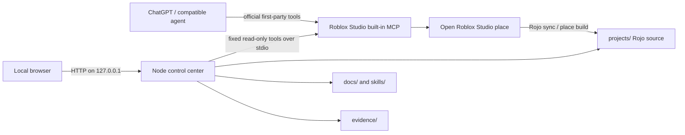

# Architecture

## Product boundary

The Lab is a local production workspace around the actual Roblox engine. Its core value is the connection between source-controlled experience projects, specialized engineering workflows, evidence from Studio, and reusable project memory. The current build implements a first operating foundation and keeps Studio-dependent capabilities visible as blocked until verified.

## Architecture options

The decision record compares the official Studio integration alone, a local dashboard around the official integration, and a custom Studio proxy. The selected design is the local dashboard plus Roblox's official MCP server; see [ADR-001](docs/architecture/ADR-001-local-control-and-studio-integration.md).

## Component map

## Data and trust boundaries

- The browser is an untrusted client. The service checks loopback Host, same-origin state changes, content type, body size, and supported routes.
- The dashboard reads only bounded local documents, project source, environment probes, and an explicit Studio tool allowlist.
- The official Studio server is a trusted local boundary only after the user enables it. Its returned place data and console text are still untrusted content.
- Roblox account permissions and Open Cloud scopes are owned by the user and remain outside the dashboard.
- Studio state is owned by the selected live instance. Project files are owned by the workspace. The Lab does not silently reconcile them.

## Runtime

The Node service uses built-in modules and no runtime dependencies. It binds to IPv4 loopback on port 4177 by default. It launches only Roblox's installed `mcp.bat` for Studio monitoring, filters inherited environment variables, bounds requests and output, tracks MCP request IDs and timeouts, and shuts down the child process when disconnected.

The MCP client supports the current stateless MCP version and the legacy `initialize` handshake. It confirms connection by listing the server tools and calling `list_roblox_studios`. The dashboard exposes named read operations only; writes and arbitrary Luau remain with the official integration.

## Knowledge, specialist matching, and project tasks

The local knowledge loader validates versioned JSON records under `docs/game-intelligence/records/`, rejects malformed, duplicate, oversized, or symlinked files, and reports dangling record links. Specialist matching reads `docs/game-intelligence/specialists/registry.json`, verifies every role contract under `skills/roles/`, and only returns an owner when that role covers the requested capabilities and output contracts and has a compatible independent reviewer.

Task plans are user-authored graphs stored under `projects/<slug>/.lab/task-plans/`. Each task records its capability requirements, selected knowledge snapshots, owner and reviewer IDs, role-contract digests, input/output artifact types, explicit file ownership, and evidence links. A plan must link input files or prerequisite outputs; review requires every expected output file; passing requires the assigned reviewer ID plus linked certification evidence. Writes use bounded JSON and revision checks. Local status records are not authenticated agent identities, and the workbench does not invoke a model provider or execute a task automatically.

The Agent Workbench reads these plans through the same loopback service. It can create proposed tasks, export structured handoffs with role text and knowledge provenance, advance states, and record project-local artifacts. Project listing derives open-task counts from the saved plans, so project state survives service restart and remains with the source project.

The acceptance register at `docs/quality/lab-capability-register.json` is a separate, validated system state. The server rejects missing implementation/evidence references, dependency cycles, unsupported status values, and `VERIFIED` entries without passing evidence. `GET /api/capabilities` exposes the register; the Control Room overview consumes its summary and open requirements.

`evidence/registry.json` indexes typed, scoped evidence and points to its original record. `src/services/evidence-registry.js` validates safe references, source hashes, project identity, and required Studio or task-execution details before `GET /api/evidence` or the overview returns them. The local Signal Garden multiplayer record exposes its PlaceId, server/two-client session identities, both separate player actions, counter replication check, and no-save closure; its result remains limited to that scenario.

## Source layout

Rojo maps project `src/shared/`, `src/server/`, and `src/client/` to their corresponding DataModel services. Source is canonical for files under `projects/`; Studio place files and build outputs are generated, ignored artifacts. The initial template contains a functional server-authoritative signal collection loop that is explicitly a graybox test, not the flagship experience.

## Reliability and failure behavior

- Missing Node/Git/Rojo is reported with an installation action; no dashboard success state is fabricated.
- Missing or disabled Studio MCP returns `disconnected`, `error`, or `empty instance list` with next-step guidance.
- MCP server errors, timeouts, malformed output, path violations, and unsupported tools return explicit API errors.
- Project builds use one named Rojo 7.7.1 operation. The service validates manifest paths, snapshots only declared project inputs, runs without a shell, records source/output hashes, and serves successful artifacts through an ID-bound download route; it does not expose a generic process endpoint.
- Build and static analysis reports preserve blocked or unmeasured gates. A clean heuristic scan is not a certificate.
- Backups are local archives; there is no automatic deletion or publishing path.
