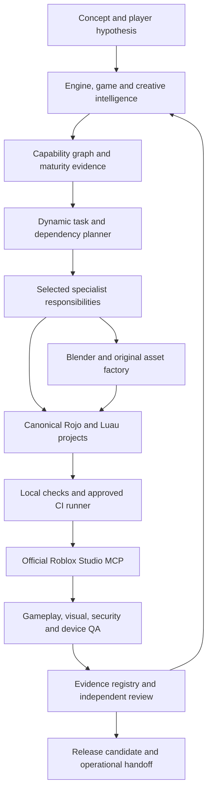

# 11vatedTech AI Roblox Studio Lab — Closure Specification

**Status:** Approved specification; implementation plans prepared; not implemented\
**Date:** 2026-11-07\
**Scope:** End state, architecture, capability gaps, implementation sequence, and certification. This document is a design specification, not evidence that any unimplemented capability has been delivered.

**Implementation roadmap:** [AI Roblox Studio Lab Closure Implementation Plan](../plans/2026-11-07-ai-roblox-studio-lab-implementation-roadmap.md)

## A. Vision and end state

The Lab is 11vatedTech’s local-first, provider-agnostic Roblox creative and engineering production environment. It should take an original concept through player and product research, game design, worldbuilding, art direction, original asset production, animation, Luau engineering, multiplayer implementation, Studio playtesting, visual review, device profiling, release preparation, and operational handoff.

The Lab must help a compatible AI workforce understand a new Roblox experience, identify its design and technical demands, compose the right specialist work, use real production tools, and prove results with repeatable evidence. It must support open-ended combinations of game genres and mechanics instead of mapping every idea to a fixed template. When a concept or API is outside the verified knowledge base, the system must expose the unknown, research it, and test a bounded implementation before claiming support.

The Lab is complete when a clean checkout can take an unfamiliar hybrid concept through this system and deliver an original, artistically approved, technically robust, release-candidate Roblox experience, backed by independent evidence. Documentation, generated content, a dashboard, an agent role file, a successful build, or a screenshot alone cannot satisfy that standard.

The production target begins at **midrange mobile and desktop**. Higher tiers may receive richer visual quality. Tablet and controller/console behavior remain part of the Lab’s device-compatibility capability and are tested when an experience declares those platforms. Lower quality tiers must preserve silhouette, readability, artistic identity, and gameplay.

The intended level is the highest practical quality the current Roblox engine and approved production tools can deliver. This is an ambitious target, not a claim that Roblox has no platform limits or that a finite knowledge base covers every possible game. The Lab must remain extensible and honest about stable, beta, experimental, permission-gated, and unavailable capabilities.

### Operating principles

- The quality of the experience determines whether the production system is good enough; convenience of the current repository does not define the bar.
- Create original art through deliberate art direction, modeling, texturing, rigging, animation, Roblox integration, and iteration. Selecting or arranging existing content is not an adequate substitute.
- Treat AI-generated meshes, textures, scenes, avatars, animations, and code as draft outputs that need technical and creative evaluation.
- Native Roblox Parts are valid for collision, grayboxing, utility geometry, and intentional art. Unfinished primitives cannot stand in for promised Hero or Major art.
- Use Roblox’s real engine, local tooling, and measured device behavior. Do not simulate capabilities the engine does not provide.
- Preserve original source files, licensing and provenance, working project files, build configuration, evidence, and known limitations.
- No provider subscription, paid service, API key, upload, asset purchase, Open Cloud scope, publishing action, or production data operation is required by default.
- Treat revenue, retention, adoption, and market demand as hypotheses until measured. The Lab can improve the quality of product decisions; it cannot promise a commercial result.

## B. Capability inventory and knowledge model

The Lab’s knowledge should be structured into three connected systems:

1. **Roblox Engine Intelligence** — current APIs, DataModel patterns, Studio/MCP capabilities, asset formats, performance characteristics, platform limits, permissions, security, and feature maturity.
2. **Game Design & Creative Intelligence** — player experience, genres, hybrid structures, mechanics, economies, narrative, visual styles, animation, art production, audio, and accessibility.
3. **Verified Production Intelligence** — real project source, asset pipelines, task plans, reusable implementations, benchmark scenarios, test results, performance profiles, approved visuals, failure patterns, and release evidence.

These systems are linked through a versioned capability graph. The graph is an extensible map of knowledge and evidence, not a genre template generator.

### Game-family taxonomy

Every experience can have multiple families and subgenres. The taxonomy must support at least:

- RPG and adventure: open-world, action RPG, quest-driven, narrative, dungeon crawler, roguelike/roguelite, soulslike-inspired, and exploration.
- Action and combat: fighting, beat ’em up, hack-and-slash, arena, boss rush, hero shooter, battle royale, melee, weapon, and ability combat.
- FPS/TPS and competitive multiplayer: tactical shooters, team deathmatch, objective play, MOBA-inspired systems, ranked play, and esports-style experiences.
- Racing and vehicles: arcade/simulation racing, drifting, vehicle combat, flight, spacecraft, off-road, and vehicle construction.
- Horror and survival: psychological and survival horror, asymmetry, co-op survival, extraction, stealth, zombies, and environmental puzzle horror.
- Simulation and management: tycoons, factories, business, life, farming, city building, economy, machinery, and ecosystems.
- Strategy and tactics: tower defense, real-time and turn-based strategy, tactical combat, auto battlers, card battlers, territory, squads, and base defense.
- Collection and progression: creatures, pets, cards, equipment, crafting, breeding, trading, and collection-driven RPGs.
- Social and roleplay: life/city roleplay, hangouts, player businesses, housing, communities, social deduction, and party games.
- Platforming and movement: obbies, precision platformers, parkour, speedrunning, grappling, momentum, physics platforming, and movement challenges.
- Sports and recreation: team sports, combat sports, golf, fishing, racing sports, and competitive minigames.
- Puzzle and experimental: environmental/physics puzzles, escape rooms, logic, time/reality manipulation, co-op problem solving, and experimental interactive art.
- Sandbox, creative, survival crafting, procedural, social simulation, and emerging forms that do not fit existing categories.

This list is a taxonomy seed, not a closed Roblox genre list. The system must support hybrids such as a creature-collection RPG with tactical card combat, an open-world extraction RPG, a survival horror game with cooperative procedural encounters, or a tycoon with simulation-driven production chains. It must reason about the components and their tradeoffs rather than retrieve a pre-authored combination and label it synthesis.

### Mechanics Intelligence Library

Each mechanic is described as a player capability and a technical system. Records cover movement, combat, weapons, abilities, physics, contextual interaction, inventory, crafting, progression, economy, collection, AI/NPCs, procedural generation, destruction, simulation, quests, narrative, social systems, multiplayer, weather, and dynamic world systems.

A mechanic package records:

- Player intent, promise, inputs, targeting, state machine, rules, tuning parameters, feedback, and recovery/failure states.
- Dependencies on animation, physics, camera, UI, sound, VFX, assets, world geometry, persistence, and other mechanics.
- Server/client ownership, remotes, network behavior, exploit risks, rate/resource limits, and authoritative state.
- Roblox classes/services/APIs and their availability, version, platform, permission, and maturity constraints.
- Keyboard, touch, controller, accessibility, latency, and performance considerations.
- Tests, visual references, profiling scenarios, known failure patterns, and linked benchmark evidence.

For example, a grappling mechanic should lead an agent to consider input recognition; target acquisition; server validation of target/range/state; attachment, constraint, or force behavior; momentum; animation transitions; camera response; sound/VFX; replication and ownership; cancellation; failure feedback; mobile/controller controls; cleanup; and repeatable tests. A designer can choose among valid implementations based on the intended feel and engine constraints.

### Art-direction and animation intelligence

Art direction must cover photorealism and stylized realism, fantasy, anime/cel shading, hand-painted 3D, cartoon, low-poly and voxel art, gothic/horror, science fiction/cyberpunk, steampunk/dieselpunk/biopunk/solarpunk, industrial, historical, cozy/whimsical, post-apocalyptic, retro, surreal/abstract, mixed media, underwater/deep sea, cosmic, and experimental styles.

A style package is a production specification, not an aesthetic label. It defines shape language, proportion, silhouette, palette, materials, texture treatment, lighting, composition, environment, character, animation, VFX, UI, sound and music identity, target-device variants, approved references, provenance, and limits. It must explain how to keep identity coherent while allowing original designs.

Animation is a first-class discipline, covering character locomotion and expression, combat, creatures, facial animation where supported, interaction, cinematics, IK and procedural motion, physics reactions, environment/machinery, UI motion, and VFX synchronization. Its standards include weight, anticipation, follow-through, timing, spacing, readable poses/silhouettes, contact accuracy, transitions, state synchronization, and responsiveness. Animation must align with movement, hit windows, damage, sound, camera, and effects; a button-triggered clip by itself is not a finished combat system.

### Knowledge records and maturity

Knowledge records are small, versioned, searchable JSON/YAML/Markdown artifacts with stable IDs and typed links. Each record carries owner/domain, source URLs and retrieval/review dates, Roblox/Studio version, platform state (stable, beta, experimental, roadmap, deprecated, or unknown), assumptions, linked source or benchmark, and maturity:

- **L1 — Knowledge:** can explain the discipline and cite reliable sources.
- **L2 — Design:** can create a complete, technically grounded specification and tradeoff analysis.
- **L3 — Execution:** has used real tools to implement and integrate the capability.
- **L4 — Certification:** an independent reviewer reproduced the result against defined quality criteria and evidence.

A record cannot advance from a claim or generated answer alone. It advances only with cited current sources, source-controlled implementation, test output, or independently reviewed benchmark evidence. Corrections and changes in platform behavior are versioned; the old fact is not silently overwritten.

### Capability graph and dynamic production planning

Graph node types include concept, player need, game family, mechanic, visual style, animation domain, engine capability, asset class, specialist responsibility, production task, test, benchmark, evidence item, and knowledge source. Links include depends-on, implemented-by, requires, validated-by, compatible-with, conflicts-with, supersedes, and supported-by.

Concept intake identifies genres/mechanics/styles as multi-label hypotheses, target audience and devices, player value, technical demands, open questions, and confidence. The planner retrieves relevant knowledge and produces a proposed design graph, risk list, task dependency graph, specialist assignments, bounded file ownership, allowed operations, and acceptance/evidence requirements. A human reviews consequential creative and external-operation decisions. New concepts and unknown nodes remain possible; the planner must request focused research or a prototype instead of fabricating support.

## C. Current repository audit

The following findings are based on the current workspace tree, current source/docs/evidence inspection, and the supplied defect register. No tests or Studio calls were run during this design pass. “Observed” refers to checked-in evidence, not a fresh run.

| Capability | Current status | Current evidence and gap |
|---|---|---|
| Local control center | Partial/working foundation | Node dashboard binds to loopback and has project, source, assets, agent, visual, performance, security, analytics, and diagnostics workspaces. Some views intentionally report unmeasured data rather than fabricate it. |
| Studio connection | Prior Studio-verified evidence; current session not rechecked | Evidence records official local MCP connection and a prior place instance. The dashboard bridge is bounded read-only. Direct official Studio tools can edit, execute, generate assets, playtest, and access separately granted capabilities. Every live task must re-list and identify the intended Studio instance/place. |
| Roblox API reference | Operational foundation, bounded | The service reads official Roblox class YAML with timeout, response, and cache limits. It covers API facts but not a structured game-design, mechanic, style, animation, or verified production knowledge graph. |
| Source projects/build | Build-evidence present | The current build report records successful Rojo 7.7.1 builds for the base template, Misprint Menagerie, and Signal Garden. This does not prove Studio play or asset correctness. |
| Git recovery | Missing baseline | Git is initialized on master, but there are no commits and all source is untracked. No remote is configured. Initial commit and restore strategy remain open implementation work. |
| Backup | Incomplete | scripts/backup.ps1 omits important repository paths including apps, src, tests, evidence, and .agents. It is not a full repository backup. A full Git bundle or equivalent restore-verified copy is required. |
| CI and Node tests | Missing/partial | No CI workflow is present. The supplied register reports 25 pass, 1 fail, and 1 skipped in an isolated Linux run; the failure is the Windows absolute-path assertion using host path semantics. The older plan reports 27 passes. The Windows test result has not been rerun in this design session. |
| Luau verification | Partial | The pinned Luau archive includes runtime, parser, and analyzer. scripts/lint-luau.ps1 calls luau-compile in parse-only mode and explicitly does not claim type analysis. Misprint .spec.luau files are not executed by test-all.ps1. |
| Signal Garden | Build and partial Studio observation | Three collections, deposits, and route selection are recorded. The archive platform spans X −22..+22; one plate on each route is at X −27 or X +27 and the plate parts are non-collidable. The saved Moss attempt dropped below the platform and timed out. A player-controlled jump was not tested, so the confirmed defect is lack of a supported continuous collidable route, not proof that no possible jump can reach it. Visual evidence describes a very dark blockout and HUD/chat overlap. Multiplayer, full reset, input, and device behavior remain unverified. |
| SignalBloom | Source exists; integration unverified | Blender source, FBX, preview, and build metadata exist; the asset ledger records 920 triangles and prior Studio presence. projects/signal-garden/default.project.json does not map the model. Rebuilt-place presence, collision, and device costs are unverified. |
| Misprint Menagerie | Build observed; Studio behavior unverified | The latest build report records a successful Rojo build. Its asset ledger and older plan contain stale build/test status. No complete Studio gameplay run or executed .spec.luau suite is recorded. |
| Asset production | Early foundation | Blender 5.2 is detected. One authored low-poly prop is present. There is no repeatable asset factory, verified Studio-to-Rojo import path, Hero review system, or library-scale provenance/update workflow. |
| Existing workforce | Useful playbooks, no orchestrator | Twenty role playbooks, operating manual, Freebuff project skill, handoff schema, and product/design templates exist. The role files are work contracts, not autonomous workers. There is no genre/mechanic/style graph, dynamic assignment, task dependency engine, or demonstrated cross-agent production cycle. |
| Creative concept research | Process seed, unvalidated | Signal Garden, Aether Relay, and Echo Cartographer were scored as design estimates. The concept document explicitly says the scores are not player validation. A separate flagship needs new audience research after foundation work. |
| Visual QA | Capture foundation | The dashboard captures real Studio viewport images and integrity metadata. It does not provide an approved visual rubric, repeatable portfolio review, systematic comparisons, or human Hero sign-off records. |
| Performance | Unmeasured | The dashboard’s performance view reports source size and correctly leaves runtime frame time, memory, network, and device status unmeasured. No midrange mobile device profile is recorded. |
| Security | Good boundary foundation; incomplete game certification | Local dashboard is loopback-only and read-only for Studio. Static heuristic findings are not a security review. Direct Studio integration has broader authority; no operation-risk matrix or completed multiplayer abuse certification exists. |
| Product and live operations | Guidance only | Local analytics view lists project CSV/JSON exports. There is no player research, live analytics, monetization test, telemetry evidence, or market validation. The current documents correctly avoid revenue claims. |
| Local AI | Inventory only | The environment report records local Ollama models including code and vision models, but explicitly says inference and model quality were not tested. No model is selected as a production dependency. |

### Capability and gap matrix

Status key: **O** = operational with evidence; **P** = partial; **UV** = built or present but unverified at the required grade; **M** = missing; **B** = blocked by a permission, platform, or hardware dependency. A partial foundation is not a pass for the complete capability.

| Capability and why it matters | Current state and evidence | Required capability / tooling | Primary owner | Integration and dependency | Acceptance test and evidence | Priority |
|---|---|---|---|---|---|---|
| Source recovery and safe change control | **M:** initialized Git only; no commits/remote, all project files untracked. Existing backup script omits core folders. | Reviewed baseline, full-source backup/bundle, clean restore, generated-file/secret review. | Production coordinator; principal architect | Git, corrected backup script, approved content inventory; no remote needed for a local bundle. | Restore into a new directory; compare source; baseline commit and clean status; backup manifest proves required paths included. | P0-01 |
| Dashboard and local control plane | **P:** loopback dashboard, project/source views, bounded API, local diagnostics and evidence workspace exist. | Keep the control plane bounded; add validated knowledge/task/evidence workflows and explicit status. | Principal architect; production coordinator | Existing Node server, stable local file schemas, path policy. | API/path/security checks; task graph can be created, advanced, reviewed, and rejected on missing prerequisites. | P1 |
| Studio connection and permission model | **P:** dashboard is read-only; prior evidence shows official Studio MCP. Direct Codex Studio tools are broader and can mutate. | Per-task Studio instance/place selection, operation-risk matrix, read/edit/external/production boundaries. | Principal Roblox architect; security engineer | Official Studio MCP only; current session inventory; no second bridge. | Resolve instance/place before action; prove dashboard has no arbitrary tool path; verify each authorized operation and its readback. | P0-05, then continuous |
| Engine intelligence | **P:** bounded live official class-reference service is implemented. | Versioned engine/tool registry with platform state, permissions, limits, sources, compatibility, and internal examples. | Roblox engine researcher; principal architect | Extend current official YAML/API reference; versioned graph records. | Each capability record has current source/revision and stable/beta/roadmap status; stale/unknown data is surfaced. | P2 |
| Genre and hybrid reasoning | **M:** concept shortlist and design brief exist; no structured family taxonomy or composition model. | Open taxonomy with multi-label families, hybrid reasoning, and unknown detection. | Genre researcher; game design director | Game Intelligence graph, audience brief, references. | Held-out hybrid is decomposed into component families, assumptions, and design tradeoffs without template matching. | P2 |
| Mechanics and game-system reasoning | **P:** gameplay, multiplayer, economy, AI/NPC and related role playbooks exist, but are not connected by dependency data. | Mechanic records covering inputs, states, dependencies, authority, animation, UI, effects, networking, failure paths, and tests. | Mechanics architect; gameplay engineer | Capability graph links mechanics to Engine Intelligence and benchmarks. | Grapple or other composed-mechanic challenge produces complete cross-discipline dependencies and measurable scenarios. | P2 |
| Art direction and original visual identity | **P:** creative/environment/technical-art playbooks and a Signal Garden style seed exist; projects remain blockout-level. | Style grammar, references/provenance, asset-class standards, repeatable rubric, final art-direction approval. | Creative/art director; independent visual QA | Visual bible, asset factory, capture reference set. | Art review records rubric dimensions, target tier, defects and explicit Hero/final-direction sign-off. | P2–P5 |
| 3D modeling, materials and asset provenance | **P:** Blender 5.2, SignalBloom source/FBX/preview, asset ledger and one prior Studio observation. | Production asset library, Blender automation, rights/provenance, export/import settings, asset update/rebuild path. | 3D asset/technical artist; environment/character artist | Blender, Studio importer, SurfaceAppearance/PBR, Rojo representation spike. | Original asset is rebuilt from source, survives clean Rojo build/reopen, meets technical contract, and has required visual approval. | P0-05, P3 |
| Character, rigging and animation | **P:** rigging/animation roles exist; current project does not demonstrate a certified animation production system. | Rig/clip/graph standards, locomotion/combat/creature/cinematic/IK and procedural workflows, synchronization tests. | Character/rig specialist; animation director | Blender source, Studio Animation Editor/Graph Editor, runtime state contracts. | Representative rig deforms correctly; graph/version status is recorded; gameplay windows, camera, audio and effects synchronize in Studio. | P3–P4 |
| Gameplay, physics, networking and NPCs | **P/UV:** Signal Garden has partial one-player behavior; Misprint has build evidence only; no verified network/physics/NPC portfolio. | Server-owned rules, genre-specific gameplay systems, constraints/physics, NPC logic, replication, failure/recovery behavior. | Gameplay, multiplayer, physics, AI/NPC engineers | Rojo source, mechanic packages, Studio multi-client harness. | Full intended scenarios pass; invalid requests, join/leave, latency, state transitions, reset and relevant collisions are recorded. | P0-04; P1–P4 |
| Luau quality, specs and project builds | **P:** Node tests, Luau parse-only script, and three Rojo builds exist; Luau analyzer is installed but unused by the script. | Explicit host-independent path contract, suitable type/static analysis, real execution of pure rules specs, all-project build gate. | Senior Luau engineer; QA director | Pinned Luau/Rojo tools; CI host decision; Studio harness for engine tests. | Windows/POSIX path tests as advertised; Luau checks state their limits; .spec.luau assertions run; builds bind to source revision. | P0-02/03; P1 |
| Agent organization and task orchestration | **P:** 20 role playbooks, Freebuff adapter, operating manual and handoff schema; no real task/dependency engine. | Capability-driven role assembly, task DAG, bounded ownership, adapters, review separation, evidence enforcement. | Production coordinator; Game Intelligence planner | Local graph and task registry, Codex/Freebuff or compatible clients, shared project artifacts. | Completed cross-agent task has dependency-ordered assignments, artifacts, independent reviewer, and reproducible evidence. | P1–P2 |
| Visual intelligence and approval | **P:** actual screenshot capture/hash storage and dashboard display; no approved rubric or systematic review. | Repeatable cameras, visual references, defect triage, device comparisons, explicit Human Hero/final art approval. | Independent visual QA; creative director | Studio captures, asset records, local vision model only after benchmark, human review. | Human visual checklist and before/after evidence; AI results remain advisory; no critical readability defects. | P1, P3 |
| Device support and performance | **M/B:** source statistics only; no runtime profile or physical midrange mobile evidence. | Device matrix, per-experience budgets, profiler workflow, quality tiers preserving identity. | Performance engineer; device compatibility QA | Studio simulator for layout/input; actual desktop and midrange mobile; optional tablet/controller checks. | Device/machine IDs, workload, frame/memory/network/loading results, graphics settings, and pass thresholds recorded. | P1, then per project |
| Product intelligence, analytics and live ops | **P:** brief, concept-selection and operations docs; dashboard only reads local analytics exports; no player data. | Audience research, test plans, minimum useful event schema, privacy/retention, ethical economy, release/support plan. | Product strategist; market/player researcher; live-ops lead | Actual player tests; Roblox Analytics only with authorized access; minimal data. | Hypothesis, method, observed results and stop/continue decision; revenue and live metrics remain unknown until measured. | P5–P6 |
| Benchmark library and flagship | **P/UV:** Signal Garden and Misprint exist; current evidence is incomplete and art is not the standard. | Verified compact benchmarks plus a separately selected, complete original flagship. | Creative director; benchmark owners; QA director | Knowledge graph, asset factory, concept research, Studio and device evidence. | Each benchmark reproduces from a clean checkout; flagship is playable, polished, original, and release-candidate certified. | P4–P6 |
| Release and operations certification | **P:** checklist and safety guidance exist; no release candidate, runbook, or live operational evidence. | Versioned RC package, rights/policy review, recovery/runbook, known issues, authorized rollout path. | Release manager; product/live operations; owner | CI, asset ledger, Studio/device/QA evidence; per-action owner approval. | Unpublished RC checklist complete; publishing and production data actions remain separate owner-authorized gates. | P6 |

### Current tool and platform constraints

- The last environment report records Windows 11, Node 24.18.0, Rojo 7.7.1, Luau 0.745, Blender 5.2.0 LTS, Roblox Studio 0.746, an NVIDIA RTX 5070 Ti Laptop GPU, and available local models. This is a dated workstation snapshot, not a current performance profile.
- The local report does not identify a physical midrange mobile test device. Exact model/device availability must be decided before performance certification.
- No CI host or repository remote is selected. A CI provider workflow can be added as source after the owner selects the approved host; do not configure a remote or push without authorization.
- The exact portable representation for SignalBloom remains an engineering spike. Do not claim an .rbxmx or asset-ID strategy works until a clean Rojo build and Studio reopen preserve the mesh content and required properties.

## D. Technical architecture

### Recommended local-first architecture

Keep the current local Node control center and official Roblox Studio MCP boundary. Add the Game Intelligence knowledge graph, production task planner, task/evidence registry, asset audit pipeline, and benchmark library as integrated Lab capabilities. Avoid building a second Studio bridge or an unrestricted model runner.

The workflow orchestrator must be real: it validates structured project briefs and knowledge records; composes dependency graphs; selects role responsibilities; allocates files and tools; records assignment, status, review, and evidence; detects unresolved dependencies; and prevents a task from being marked complete without its required artifacts. Agent execution may occur in Codex, Freebuff, or another compatible client through a stable adapter. The core graph, task state, evidence, and permissions must remain provider-neutral and usable from repository artifacts when a client lacks a direct integration.

The initial orchestration layer does not need to launch arbitrary shell commands, arbitrary MCP calls, or proprietary model agents. It must create valid work plans and handoffs that agents actually execute, and it must verify their outcomes with bounded local commands and Studio evidence. Add a model/provider execution adapter only when the available client has a supported interface and the operation can be permission-scoped. Do not use a role folder as a substitute for this workflow engine.

### Component map

### Core interfaces

- **Project brief:** player promise, target audience, mechanics, genre/style hypotheses, platforms, scope, authority model, constraints, and unresolved questions.
- **Knowledge record:** stable ID, domain, relationships, source provenance, engine/version state, maturity, owner, last-reviewed date, and linked evidence.
- **Capability graph:** selected knowledge nodes plus dependencies, conflicts, assumptions, and required proofs for a specific experience.
- **Task record:** objective, specialist responsibility, prerequisites, exact project and file ownership, accepted tools/operations, outputs, checks, risks, and evidence requirements.
- **Asset record:** class, purpose, source, rights, hashes, dependencies, authoring and export configuration, technical budgets, Studio import/build information, and separate review statuses.
- **Evidence record:** commit or source digest, tool versions, command/scenario, status, environment, Studio instance/place where applicable, device/network profile, raw output, captures/hashes, reviewer, and limitations.
- **Handoff:** extend the existing schema with task IDs, dependency status, file ownership, capability maturity, and evidence references while preserving its explicit passed/failed/blocked/not_run statuses.

Store authoritative knowledge as compact versioned files with typed IDs and links. Use existing local search and structured filtering first. A local vector index can be evaluated for recall later, but no external embedding service or model is mandatory. The current Roblox API-reference service remains the source for current class data; it should not duplicate or freeze that upstream reference.

### Operation-risk model

Every Studio action is classified as:

1. **Read:** inspect Studio state, tree, scripts, console, API docs, or viewport.
2. **Local edit:** mutate an unpublished test place or local source; capture a recoverable copy first for substantial changes.
3. **External write:** upload assets, create persistent Roblox assets, or change cloud-owned content.
4. **Production-impacting:** publish, change live settings, operate monetization, access live analytics, or read/write player data.

The dashboard remains a fixed read-only client. Direct official tools are selected by Studio instance ID and actual tool availability. External-write and production-impacting actions are never implied by a general development request; they need explicit authorization for the exact action and place. Open Cloud permissions remain disabled by default.

## E. Creative production factory

The factory must produce professional original artwork as well as import and arrange it. It integrates concept art and reference studies, original Blender modeling, AI-assisted concepts/meshes/materials, retopology and UVs, textures/PBR, rigging/skinning, animation, environment construction, lighting, VFX, sound design, music composition/adaptation, Roblox integration, performance variants, and reusable asset maintenance.

### Mandatory asset lifecycle

1. **Direction:** record intended player function, art pillars, references/provenance, style grammar, audience, target devices, and what makes the asset recognizable.
2. **Specification:** define asset class, silhouette, dimensions/scale, pivot/origin, rig/attachments, materials/textures, collision, LOD, streaming, interactivity, dependencies, and per-project performance targets.
3. **Original authoring:** preserve editable .blend, source textures, procedural/generative source, and intermediate files. AI-generated content may enter the workflow but cannot bypass art direction, cleanup, and rights review.
4. **Technical audit:** run deterministic Blender checks where applicable for dimensions, transforms, object names, mesh statistics, UVs, texture references, rig/bone expectations, export configuration, dependency completeness, and required collision/LOD variants.
5. **Export/import:** use versioned FBX/glTF/OBJ presets and Roblox Studio’s importer. Validate scale, orientation, names, materials, rigging, animations, and warnings in Studio. Select a canonical Rojo representation only after an end-to-end clean-build test.
6. **Roblox integration:** preserve intended Model/MeshPart hierarchy, pivot, collision/render fidelity, tags/attributes, animation/controller behavior, and project mapping. Separate asset editing from persistent uploads.
7. **Quality gates:** record technical validation, in-place integration, device profiling, AI-assisted defect triage, and artistic approval as independent outcomes.
8. **Library release:** version source and outputs, hashes, dependencies, provenance, preview, import record, review notes, and regression procedure. A future update must not require rebuilding unrelated assets.

### Asset classifications

Every asset has exactly one primary class, with optional secondary tags:

- **Hero:** signature characters, bosses, creatures, weapons, vehicles, landmarks, or defining objects. Requires deliberate art direction and explicit human visual approval. Technical checks alone cannot pass it.
- **Major:** buildings, significant creatures/vehicles, modular environment systems, and high-visibility gameplay assets. Requires focused art and technical review.
- **Supporting:** props, vegetation, clutter, and environmental decoration. May use batch automation and sample human review under an approved style guide.
- **Utility:** collision, invisible helpers, bounds, sockets, and functional geometry. Review emphasizes behavior, naming, performance, and noninterference; visible utility art still follows the style guide.

### Provenance and technical contract

Retain original Blender projects, textures, generated sources and prompts where policy permits, export presets, tool and dependency versions, source/output hashes, license/usage status, Roblox import settings, final hierarchy, persistent asset IDs only after authorized upload, and build/review evidence. Record dimensions, triangle/mesh statistics, texture sizes, material maps, rig data, collision fidelity, LOD/render options, streaming behavior, expected device tiers, and known tradeoffs. Do not treat generated content or a Creator Store description as proof of license. Assets and reference materials distributed in the Lab’s reusable production library must be Lab-original/owned or have documented reuse rights for the intended scope; project-specific licenses and restrictions travel with each asset.

### Visual acceptance rubric

Review silhouette and shape language; modeling/geometric quality; UV and texture integrity; materials; artistic coherence; presentation/composition; visual readability; animation/deformation when applicable; Roblox integration; and performance appropriateness. Use an anchored 1–5 scale: 1 = unusable, 2 = weak, 3 = meets the specified functional/art baseline, 4 = polished and coherent, 5 = defining/excellent for the chosen art direction. The brief sets project-specific thresholds before review. Hero review records each category, defects, reference comparisons, reviewer, and signed approval; an average cannot hide a critical failure. Supporting-asset approval can use automated batch checks and risk-based sampling.

Automated tools can verify measurable properties and identify candidate defects. Vision models may create triage notes or compare captures, but cannot grant artistic approval for Hero assets or final art direction. Higher/lower device tiers may reduce geometry, texture resolution, effects, and environmental complexity only while preserving the asset’s essential identity and gameplay readability.

### Studio and local asset tools

Blender 5.2 is detected locally. Roblox Studio’s importer supports FBX, glTF, and OBJ and can import supported meshes with PBR textures, rigging, skinning, and animation data. Studio MCP documentation describes AI mesh/material generation; the current Codex-visible tool schemas also expose scene, texture, avatar, and animation generation. Some generation operations mutate the open place, replace a source mesh, or upload a persistent asset. Recheck the active tool list and classify each operation before use. Generated procedural models built from primitive Parts are for grayboxing, utility, or deliberate authored styles; they do not satisfy a Hero-art requirement.

## F. Agent organization and orchestration

Organize responsibilities into five divisions. These are dynamically assembled capabilities, not a requirement to run dozens of permanent agents.

1. **Game Intelligence:** genre researcher, game/systems designer, mechanics architect, player-experience designer, economy/progression designer, narrative/worldbuilding specialist.
2. **Creative Production:** executive/creative and art direction, concept development, environment and character art, 3D modeling, technical art, materials/textures, rigging, animation, VFX, sound design and music, UI/UX.
3. **Engineering:** principal Roblox architecture, Luau, gameplay, physics, networking/multiplayer, AI/NPC, UI engineering, data/persistence when in scope.
4. **Quality & Verification:** independent code reviewer, gameplay QA, visual QA, multiplayer QA, security, performance, accessibility/device compatibility, asset review.
5. **Product & Operations:** product strategy, market/player research, analytics/privacy, production coordination, release management, community/live operations.

The current playbooks cover many of these responsibilities. The closure work should add missing narrative/worldbuilding, production coordination, mechanics/game-intelligence, and independent visual-QA contracts where needed. It must not create role files without connecting them to task selection, inputs/outputs, file ownership, acceptance, permissions, and independent review.

For a new concept, a coordinator builds a graph of required work, selects relevant roles from dependencies, assigns bounded tasks, checks file conflicts, records tool permissions, and links outputs to accepted knowledge. Agents may use separate worktrees for independent changes. The integrator checks dependencies and runs declared validation; the reviewer must not certify work it authored. Every handoff follows the project schema and includes exact project/place, changes, assumptions, decisions, commands/status, evidence, risks, and next action.

### Dynamic composition quality test

The test concept is an unfamiliar hybrid not present verbatim in the knowledge packages. The system must identify its component families, explain why each specialist is needed, detect missing expertise/engine facts, produce a dependency-ordered task graph, identify security/performance/visual risks, and keep new composition original. After execution, independent QA checks whether any subsystem or interaction was omitted. The test fails if the planner merely selects a prebuilt template or invents L3/L4 status.

## G. Roblox engine integration and knowledge registry

The Engine Intelligence Registry covers DataModel and Rojo structure; Luau, type checking and static analysis; rendering, lighting, terrain, geometry, materials and PBR; MeshParts/import; animation, rigs, IK and animation graphs; UI, camera, and input; physics/constraints; audio and effects; NPC/pathfinding; replication/network ownership/server authority; StreamingEnabled; persistence and platform services; device/testing/profiling; asset publishing, monetization, analytics, and operational permissions.

For each capability, store: official sources, API/version, stable/beta/experimental/roadmap/deprecated status, supported platform/device, permission requirements, compatibility constraints, implementation examples, security/performance implications, related mechanics, and linked benchmark/test evidence. Roblox feature announcements are not dependencies until the feature is available in the actual Studio version used for a project. Recheck relevant official docs and session tool inventory before depending on version-sensitive behavior.

### Current integration facts and limits

- Roblox’s Studio MCP server is a local stdio service. It supports compatible clients, but the connected client and user permissions determine available operations. It can inspect and modify the open place; a connection is not inherently read-only.
- The current Codex-visible Roblox tool inventory includes script search/read/edit, Luau execution, model/tree inspection, generated mesh/material/texture/scene/avatar/animation operations, asset search/insertion/upload, play controls, keyboard/mouse input, viewport capture, Studio skills, and Open Cloud invocation. This inventory is specific to the current integration context and is not a promise that another client or Studio build has the same tools.
- The dashboard uses a narrower read-only allowlist. Preserve that distinction. All live operations must begin with list_roblox_studios, instance selection, place identity, current state inspection, and permission classification.
- Studio’s 3D Importer and Blender workflows are supported for relevant interchange formats; the final persistent representation for each asset must be verified in a Rojo build and reopened place.
- Roblox documents a Device Simulator, StudioTestService and VirtualInput for test workflows. These simulate layout/input and multiple clients; physical hardware is still needed to certify memory and runtime performance.
- Server authority and animation graph capabilities have feature/version status that may vary. Use only after current docs and the actual Studio version confirm availability. Do not architect every game around server authority or a beta graph by default.
- Open Cloud permissions are per game and can permit external writes, uploads, settings changes, analytics, or real data-store access. Default all such scopes off.

The internal engine reference already fetches official Roblox class YAML with request/response and cache limits. Extend its linked knowledge graph and freshness records; retain authoritative source links rather than copying the whole API catalog into prompts.

## H. Quality laboratory, security, visual QA, and performance

### Validation stages

1. **Design-valid:** player promise, mechanics, target players/devices, art direction, interfaces, risks, and acceptance criteria reviewed.
2. **Source-valid:** Node tests, path-policy checks, pure Luau tests, static analysis, type checks where supported, lint/format, dependency inventory, and security checks pass.
3. **Build-valid:** pinned Rojo builds produce reproducible projects; asset mappings and manifests resolve; reports bind to a commit or source digest.
4. **Studio-tested:** selected Studio instance/place, DataModel, client/server state, scenarios, console, reset/recovery, and input behavior are inspected and recorded.
5. **Multiplayer/security-tested:** multiple clients, join/leave/respawn, latency, invalid remotes, ownership/range/state/rate boundaries, and failure cases are exercised as applicable.
6. **Visually reviewed:** repeatable camera views, asset-specific rubric, hierarchy/readability, UI/core-chat clearance, motion/accessibility, and before/after comparison are reviewed by an independent visual reviewer. Hero assets and final art direction receive human sign-off.
7. **Device/performance-tested:** target device identity, graphics settings, workload, session duration, frame-time behavior, memory, draw/instance/physics counts, loading/join time, network and server heartbeat are measured against budgets defined before the run.
8. **Product-validated:** the player/audience hypothesis and the decision from actual playtests or research are recorded. Market metrics remain unknown until measured.
9. **Release-certified:** source, assets/rights, platform/policy review, compatibility, operations and rollback evidence are complete. An unpublished RC may be certified without publication.

CI should run source-level checks and all builds without Roblox account permissions. Studio-dependent gates remain separate evidence from the actual local Studio run. A Git host/CI provider must be selected before the Lab can claim hosted CI; until then the canonical local command remains the check, and hosted CI is blocked.

### Evidence record

Each check uses passed, failed, blocked, or not_run. Evidence includes commit SHA or source-file digest (and dirty-tree state), tool versions, command/test identifier, raw output, timestamp, machine/device profile, Studio instance/place ID when relevant, scenario, network/graphics conditions, capture hash, reviewer, result, and limitations. Reports must not infer a passing gate from another grade. Static heuristics are not security certification; source size is not a performance profile; a screenshot is not gameplay proof; a local build is not a published experience.

### Security and authority standards

Server-owned systems validate every client request’s type/shape, ownership, ancestry, range, permissions, gameplay state, cooldown/rate, and resource bounds. Test tampering, stale state, forged instances, repeat requests, disconnects, and network ownership risks. Data stores, purchases, analytics, remote HTTP, uploads, and publishing require specific scope design and owner approval. Player data collection is minimized, purpose-bound, access-controlled, and retention-limited.

### Performance and accessibility

No universal triangle or texture budget is declared. Each experience sets budgets using representative content and target hardware; larger tier budgets cannot erase the midrange-mobile acceptance target. Device simulation supports layout and input review; it does not replace physical memory/performance measurements. Test touch, keyboard/mouse, controller, safe areas, orientation, chat/core UI, readable contrast, reduced motion, and accessibility alternatives where applicable.

The official Roblox performance documentation describes a 60 FPS client target by default, equivalent to 16.67 ms per frame. Treat it as a useful reference, not a universal minimum for every design. Define an experience-specific target, stress profile, sample duration, and acceptable worst-case behavior before optimization.

## I. Showcase and benchmark strategy

Signal Garden and Misprint Menagerie are retained as engineering/production benchmarks, not as the artistic ceiling:

- **Signal Garden:** cooperative traversal, route state, interactions, restorative world response, server-owned shared state, input/device readability, authored marsh environment, lighting, and asset integration. First fix its supported traversal path and verify the full loop.
- **Misprint Menagerie:** collection, summons, encounters, combat rules, NPC/creature behavior, animation, progression, and reset/replay. First run the Studio loop and execute its rules tests.

The separate flagship is chosen after the P0 foundation, production pipeline spike, concept research, and audience tests. The existing concept shortlist is useful discovery input, but its scores are design estimates, not demand evidence. Evaluate multiple original concepts using player promise, differentiation, mechanics and creative range, audience evidence, production cost, Roblox fit, and benchmark value. The selected game must have a complete player experience and coherent original art, not merely a technical vertical slice.

Create a compact verified benchmark portfolio for:

1. Character animation, combat timing, hit detection, VFX, and camera response.
2. Movement/parkour/physics interaction and mobile/controller inputs.
3. Vehicle physics, networking, and recovery.
4. Dense custom-art environment, PBR/material variation, lighting, streaming, and tiered LOD.
5. Creature/NPC perception, navigation, state, and animation.
6. Multiplayer synchronization, server validation, and network stress.
7. Procedural worlds/dungeons, navigation, deterministic rules, and controlled variation.
8. Cinematic animation/audio synchronization and advanced responsive UI/accessibility.

These are small independent reference projects or scenes, not eight full commercial games. Each contains canonical source, version/tool manifest, build instructions, design/risk notes, repeatable test scenarios and expected results, visual reference, measured target profile, evidence, limitations, and maturity. A benchmark is not certified until an independent agent can reproduce it from a clean checkout.

## J. Implementation backlog and dependencies

The sequence below closes the verified foundation before broad expansion. Each phase ends with evidence; later work does not erase blocked gates.

### Phase 0 — recoverable baseline and quality gate (first engineering sprint)

1. Review .gitignore, tracked/untracked files, secrets, and generated/local artifacts. Create a reviewed initial commit of the intended source and documentation. Do not configure or push to a remote without owner-approved destination.
2. Produce a full-repository backup or Git bundle, restore it into a new directory, compare it with the baseline, and update scripts/backup.ps1 so it cannot omit core source, tests, apps, evidence, skills, manifests, or required docs.
3. Define a host-independent path input contract. Explicitly test Windows/POSIX absolute paths, drive roots, UNC/authority-like paths, rooted paths, traversal, invalid segments, and symlinks. Run on Windows and a POSIX host if cross-platform Node behavior is claimed; Windows remains the required Studio workstation.
4. Keep the complete source gate runnable locally on the supported host. Add a hosted CI workflow only if an owner-approved provider and remote are selected; it must need no Roblox account credentials or Studio scopes. Until then, local verification is the accepted control-plane path and hosted CI remains an optional, unconfigured capability.
5. Repair Signal Garden route geometry symmetrically with continuous collidable traversal to both plates. Keep interaction prompts separate from support geometry where useful. Add geometry assertions and complete collection → deposit → route choice → both plates → restoration/reset for both routes, solo and with multiple clients.
6. Spike SignalBloom import/serialization. Preserve source; test scale, pivot, descendant count, collision, material and device budgets; map the chosen representation into canonical Rojo source. Do not upload without explicit authorization.
7. Run Node, Luau, and all three Rojo builds on the chosen host(s); regenerate reports with source revision/digest, tool versions, platform, and exact status. Correct stale README, plan, ledger, and evidence claims.

**Exit:** clean reviewed baseline; restore test passes; local quality gate status is truthful (and hosted CI is configured only if separately selected); path contract is explicit; both route loops and SignalBloom persistence have passed their stated tests or remain explicitly blocked.

### Phase 1 — executable test and evidence foundations

- Execute pure rules tests using the pinned CLI only where semantics match Roblox; execute engine behavior through StudioTestService or a verified Studio harness.
- Use luau-analyze for suitable pure modules and investigate a sound Roblox API type-definition path. Do not claim engine-aware type validation from stock Luau parse mode.
- Separate quick CI checks from Studio integration and physical-device acceptance.
- Bind every generated report to commit/digest, toolchain, and environment. Create structured visual, performance, and Studio scenario records.
- Add operation-risk matrix and task/handoff validation to the agent workflow.

### Phase 2 — Game Intelligence registry and task orchestration

- Define schemas for taxonomy, mechanics, styles, animation domains, engine capabilities, source records, task graphs, benchmark entries, and evidence.
- Seed all families and disciplines in Section B with cited L1/L2 records and explicit unknowns.
- Build structured search and graph traversal into the local workbench. Import current official engine class facts from the existing reference service by link/revision, not copied prompt snapshots.
- Implement concept intake, uncertainty recording, dynamic specialist/dependency planning, bounded task ownership, task status, review assignment, and evidence requirements.
- Run cross-agent delivery exercises using available clients. A provider adapter is certified only after the client actually consumes a task and returns the expected artifacts; unsupported app automation remains a human-directed handoff.
- Record L1–L4 and prevent automatic promotions without evidence/reviewer.

### Phase 3 — asset factory and first Hero proof

- Define technical manifests and asset-class policies.
- Create Blender headless audits and pinned FBX/glTF export presets; validate geometry, UVs, textures, naming, rig expectations, and asset dependencies where applicable.
- Complete the Roblox import/build representation spike before making it a mandatory project pipeline.
- Produce an original Hero asset from brief through source, review, Studio integration, and target-profile performance. Keep technical pass and artistic approval separate.
- Demonstrate update/reimport and clean-checkout reproducibility without rebuilding unrelated content.

### Phase 4 — representative benchmark library

- Prioritize benchmark scenes by technical domain and evidence risk.
- Build the eight compact benchmarks listed in Section I, with each implementation linked to engine, mechanic, asset, and test nodes.
- Run independent clean-checkout reproduction and the relevant Studio/device profiles; publish maturity only from results.

### Phase 5 — new flagship selection and production

- Research audience and comparable experiences; generate at least three distinct original concepts; identify what evidence would reject each.
- Run concept/user tests before selecting. Keep design scores separate from observed feedback and market metrics.
- Write an art bible and full game design brief; choose the dynamic specialist plan; agree budgets/acceptance before production.
- Create original character, world, animation, audio, VFX, and UI assets at the required quality; build complete gameplay and progression loops using server-authoritative rules appropriate to the genre.
- Validate solo/multiplayer as appropriate to design, device input, visual quality, accessibility, security, performance, and replay behavior. Do not call a graybox or vertical slice the finished flagship.

### Phase 6 — unfamiliar hybrid and operational certification

- Challenge the planner with a held-out hybrid concept and verify its graph, task decomposition, uncertainty, and specialist selection.
- Execute a bounded but complete playable production slice using the planned roles and tools. Use a distinct QA agent; verify task/handoff/evidence integrity.
- Produce an unpublished release candidate, operations/runbook, rollback plan, privacy/analytics decision, known-issues list, and owner handoff. Publishing and live data access are separate authorization steps.

## K. Final Lab certification

The Lab may be declared complete only when all required gates below have passed and are reviewable from repository evidence. “Blocked,” “not_run,” or “assumed” never means passed.

1. **Recoverability:** baseline commit exists; the full backup/bundle restores; clean checkout is reproducible; no secrets or ignored runtime outputs are committed.
2. **Portable setup:** a compatible second agent follows root docs/skill and independently identifies the project, toolchain, build/test commands, permissions, and open risks without private conversation context.
3. **Knowledge breadth:** L1/L2 records cover the game families, mechanics, art styles, animation, Roblox engine, product, and validation disciplines in the accepted taxonomy. Each has sources/version state and a path to extension.
4. **Composition:** the held-out hybrid challenge produces an original, reasoned design/dependency graph and required specialist task plan, reports unknowns, and passes expert review without selecting a fixed combo template.
5. **Execution maturity:** representative genre/mechanic benchmarks reach L3/L4 with source, build, runtime, visual, and performance evidence as applicable. Benchmarks and flagship cover different capability classes.
6. **Creative production:** one original Hero asset is fully sourced, reproducible, integrated, technically budgeted, rubric-reviewed, and human-approved. Additional asset classes demonstrate batch quality controls and provenance.
7. **Flagship:** a separate concept selected after player/audience research becomes a complete, polished, original, playable experience with no unfinished primitive stand-ins for promised art.
8. **Agent organization:** a real dynamic task graph selects specialists by dependency; tasks have ownership, artifact contracts, evidence, and independent review; a completed cycle works through the selected compatible clients.
9. **Engineering and security:** Node, Luau, and Rojo checks pass; Studio scenarios cover real server/client state, remote abuse/failure cases, multiplayer as designed, reset/respawn and supported inputs; no static heuristic is misreported as certification.
10. **Visual quality:** Hero assets and final art direction have human approval; repeatable views are readable and coherent; AI visual results are advisory; lower tiers preserve identity.
11. **Performance and compatibility:** actual target midrange mobile and desktop results meet previously declared experience-specific budgets; tablet/controller/console support is separately checked when claimed; emulator-only results do not certify physical memory/performance.
12. **Product operations:** audience/player value is supported by recorded research or clearly marked as unresolved; analytics are purpose-bound/minimal; monetization and live operations are documented without claims of guaranteed revenue.
13. **Release preparation:** an unpublished RC has full evidence and runbook. Production publishing, live settings, uploads, purchases, monetization, player data, and Open Cloud remain individually owner-authorized.
14. **Evidence integrity:** every required status links to source revision/digest, commands/scenarios, tool versions, actual outputs, Studio/place/device identity where relevant, reviewer, and known limitations.

This standard certifies a versatile production Lab with demonstrated capability across representative domains and a credible process for extending to new ones. It does not claim mastery of every imaginable game, guarantee financial success, or certify a public release that was not authorized and tested.

## L. Operational handoff

For each future Roblox experience, the receiving agent should:

1. Read AGENTS.md, README.md, ARCHITECTURE.md, the selected project manifest/brief, current status, and relevant evidence.
2. Verify repository state, tool versions, and the exact project. Preserve existing work.
3. Call list_roblox_studios before a live operation; select the instance by returned ID and confirm place identity. Inspect the hierarchy before mutation.
4. Create or update the structured concept brief; let the planner propose game families, mechanics, style, engine needs, dependencies, specialists, risks, and questions.
5. Review assumptions and human-gated decisions. Assign bounded tasks with dependencies, allowed operations, file ownership, acceptance checks, and evidence outputs.
6. Produce design and original assets from source. Update provenance and technical manifests. Keep gameplay state server-authoritative where applicable.
7. Run source tests/builds. Execute Studio, multiplayer, visual, performance, and player tests at the required evidence grade.
8. Obtain independent review; update task state only with actual result evidence.
9. Update verified knowledge only when there is a source or reproducible benchmark. Mark unverified observations and failed experiments as such.
10. Produce a handoff listing project/place, changed files, assumptions, decisions, command outcomes, evidence, risks, and next actionable gate.

The Lab’s global knowledge remains reusable and provider-neutral; game-specific architecture, narrative, art direction, assets, and evidence remain inside that game’s project. A task may not silently authorize publication, upload, production data writes, purchases, paid tools, or account permission changes.

## Current official references

The following official sources were consulted on 2026-11-07. Their content and feature status can change; the registry should refresh relevant entries before implementation and record the retrieval date.

- [Connect to the Roblox Studio MCP server](https://create.roblox.com/docs/studio/mcp) — local stdio model, tool families, and client connection.
- [Use Open Cloud with the Studio MCP server](https://create.roblox.com/docs/studio/mcp-open-cloud) — per-game permission scopes, uploads, settings, analytics, and data-store risks.
- [Studio testing modes](https://create.roblox.com/docs/studio/testing-modes) — client/server and multi-client testing, device/network simulation, and scripted testing services.
- [Device Simulator](https://create.roblox.com/docs/studio/device-simulator) — device categories and input/layout simulation.
- [Performance design](https://create.roblox.com/docs/performance-optimization/design) and [Improve performance](https://create.roblox.com/docs/performance-optimization/improve) — physical device profiling, render, memory, draw calls, and collision guidance.
- [Secure the client-server boundary](https://create.roblox.com/docs/scripting/security/client-server-boundary) and [Server authority model](https://create.roblox.com/docs/projects/server-authority) — remote validation, network ownership, and server-authoritative simulation.
- [Studio Importer](https://create.roblox.com/docs/studio/importer), [Custom 3D assets](https://create.roblox.com/docs/art/modeling), and [Blender workflow](https://create.roblox.com/docs/art/blender) — interchange formats, import settings, PBR, rigs, animation, scale, and orientation.
- [SurfaceAppearance](https://create.roblox.com/docs/reference/engine/classes/SurfaceAppearance) — device-dependent PBR presentation.
- [Blender 5.2 import/export manual](https://docs.blender.org/manual/en/5.2/files/import_export/index.html) — local source/export formats.
- [Luau type checking](https://create.roblox.com/docs/luau/type-checking) — gradual type system and analysis modes.
- [Animation Graph Editor](https://create.roblox.com/docs/animation/graph-editor), [IKControl](https://create.roblox.com/docs/reference/engine/classes/IKControl), and [Creator updates](https://create.roblox.com/updates) — current animation authoring and beta status.
- [Roblox Analytics](https://create.roblox.com/docs/production/analytics) and [monetization](https://create.roblox.com/docs/get-started/monetization) — current product/analytics surfaces; live use remains permission- and policy-gated.
- [Creator Roadmap 2026: Fall Update](https://devforum.roblox.com/t/creator-roadmap-2026-fall-update/4880208/1) — roadmap items are not treated as available dependencies until they ship in the target Studio version.
